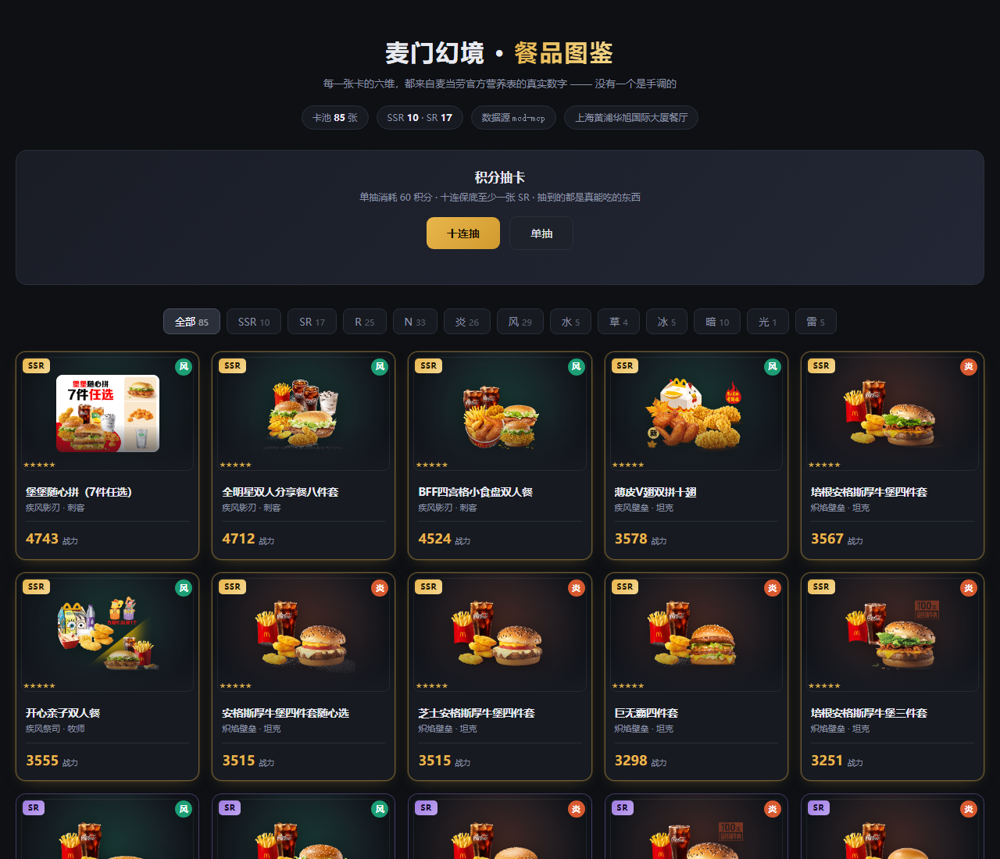

# 麦门幻境 · McdGacha

**把麦当劳菜单编译成 85 张二次元卡牌。每一张卡的六维，都来自官方营养表的真实数字。**

不是手调的数值，不是拍脑袋的稀有度。攻击力是热量，防御力是蛋白质，生命值是脂肪，暴击率是钠含量。
你在游戏里看到的每一个数字，都能在麦当劳官方营养表里找到对应那一行。



> 开启 GitHub Pages（Settings → Pages → 选 `docs/`）后可直接在线试玩：卡牌详情、元素筛选、十连抽。

---

## 先说三个反直觉的结论

用真实数据算完，有些结果和直觉不太一样。

### 1. 每元蛋白质之王不是巨无霸

| 餐品 | 价格 | 蛋白质 | 每元蛋白质 |
|---|---:|---:|---:|
| **蘸酱麦麦脆汁鸡** | **¥11.9** | 21.0 g | **1.76 g** |
| 巨无霸 | ¥25.5 | 27.0 g | 1.06 g |
| 麦辣鸡腿汉堡 | ¥22.5 | 24.0 g | 1.07 g |
| 培根安格斯厚牛堡 | ¥34.5 | 34.0 g | 0.99 g |

**最便宜的炸鸡，每元蛋白质比巨无霸高 66%，比 34.5 元的安格斯厚牛堡高 78%。**
贵，不等于值。

### 2. 5 块钱的圆筒冰淇淋，是全卡池性价比之王

圆筒冰淇淋 ¥5.0，战力 826，**每元 165 战力** —— 全场第一。
而 ¥7.5 的纯悦（一瓶水）战力只有 **5**，每元 0.7。

这是整个卡池里最强和最弱的对比：**价格只差 1.5 倍，战力差 165 倍。**

### 3. 一份套餐的钠，是你一天的两倍

卡池里钠含量最高的「堡堡随心拼（7件任选）」：

- 钠 **4027 mg**
- 成人每日推荐摄入量约 2000 mg
- **一份 = 2 倍日推荐量**

它同时也是 SSR，暴击值 999（满值）。这个设定不是我们编的，是数据本身就这么咸。

---

## 卡面预览

| SSR · 风·刺客 | SR · 炎·坦克 | R · 炎·刺客 | N · 水·灵体 |
|:---:|:---:|:---:|:---:|
|  |  |  |  |
| **堡堡随心拼**<br>疾风影刃<br>战力 **4743** | **培根安格斯厚牛堡**<br>炽焰壁垒<br>战力 **2742** | **巨无霸**<br>炽焰影刃<br>战力 **2403** | **纯悦**<br>碧涛残影<br>战力 **5** |
| ATK 945 · DEF 999<br>HP 999 · CRT 999 | ATK 763 · DEF 720<br>HP 827 · CRT 589 | ATK 699 · DEF 660<br>HP 694 · CRT 572 | ATK 1 · DEF 1<br>HP 1 · CRT 1 |

---

## 六维是怎么算出来的

没有任何一个数字是手工填的。

| 属性 | 来源 | 含义 |
|---|---|---|
| **ATK 攻击** | 能量 (kcal) | 热量即输出 |
| **DEF 防御** | 蛋白质 (g) | 每一克都是护甲 |
| **HP 生命** | 脂肪 (g) | 脂肪是血条 |
| **SPD 速度** | 碳水 (g) | 碳水灌注 |
| **CRT 暴击** | 钠 (mg) | 咸度决定暴击率 |
| **HEAL 治疗** | 钙 (mg) | 钙质庇护 |

**数值缩放**（压缩极端值，让 93 kcal 的圆筒和 2142 kcal 的双人餐都能同台）：

```
stat = round(999 × (value / max)^0.55)
```

**战力**（蛋白质权重最高，钠最低）：

```
power = ATK×1.0 + DEF×1.6 + HP×0.8 + SPD×0.6 + CRT×0.5 + HEAL×0.4
```

**职业**不看份量，看营养结构：先算每个维度的「每千卡占比」，再在全部卡里排分位，
哪一维的分位最高就是哪个职业。所以双人餐不会因为份量大就自动变成坦克。

**稀有度**按战力分位：SSR 前 12%、SR 到 32%、R 到 62%，其余 N。

当前卡池分布：

```
稀有度  SSR 10 · SR 17 · R 25 · N 33
职业    法师 22 · 坦克 20 · 刺客 18 · 牧师 16 · 灵体 5 · 战士 4
元素    风 29 · 炎 26 · 暗 10 · 水 5 · 冰 5 · 雷 5 · 草 4 · 光 1
```

---

## 快速开始

### 1. 拿 Token

打开 [open.mcd.cn/mcp](https://open.mcd.cn/mcp) → 右上角登录（手机号）→ 控制台 → 激活 → 复制 Token。

### 2. 接入 WorkBuddy

左侧边栏【专家·技能·连接器】→【连接器】→ 右上角【自定义连接器】→【配置 MCP】，粘贴：

```json
{
  "mcpServers": {
    "mcd-mcp": {
      "type": "streamablehttp",
      "url": "https://mcp.mcd.cn",
      "headers": {
        "Authorization": "Bearer 你的_TOKEN"
      }
    }
  }
}
```

保存后回到【自定义连接器】把 `mcd-mcp` 启用。

### 3. 构建卡池

```bash
export MCD_TOKEN=你的_TOKEN

# 拉菜单 + 营养表，编译成角色名册
python src/build_roster.py --city 上海市 --keyword 人民广场

# 算六维、职业、稀有度
python src/stats.py

# 渲染成静态图鉴页
python src/render.py
# → docs/index.html
```

只用标准库，无需 `pip install`。

### 4. 打开图鉴

直接双击 `docs/index.html`，或推到 GitHub 后在 Settings → Pages 里选 `docs/` 目录。

---

## MCP 调用链路

```
query-nearby-stores  →  storeCode
        ↓
query-meals          →  120 道菜（名称 / 价格 / 图片 / 分类）
        ↓
query-meal-detail    →  套餐的默认搭配（拆成单品）
        ↓
list-nutrition-foods →  官方营养表（160 条单品营养）
        ↓
   逐单品匹配 → 按份数累加 → 套餐营养
```

**最关键的一步是套餐拆解。** 官方营养表只有单品数据，套餐没有。
我们用 `query-meal-detail` 取默认搭配，拆成单品逐个查表再累加——
所以「麦辣鸡腿汉堡三件套」的营养 = 汉堡 + 中薯条 + 可乐，每一克都可追溯。

详细说明见 [MCP_INTEGRATION.md](./MCP_INTEGRATION.md)。

---

## 数据可信度：缺的就说缺

- 菜单 **120** 项 → 排除周边玩具 **5** 项 → 卡池 **115** 项
- 营养完整可追溯 **85** 张（**74%**）
- 剩余 30 项是龙焰系列、心形薯饼、麦炫酷等**官方营养表尚未收录的新品**

对这部分，我们**明确标记并移出卡池，不按比例估算**。

> 宁可少一张卡，不可错一个数。

如果按比例瞎补，卡池能凑到 115 张，数字也更好看。
但那就不再是「真实数据」了，只是另一种编故事。

---

## 项目结构

```
mcd-gacha/
├── src/
│   ├── mcp_client.py      # 最小 MCP 客户端（Streamable HTTP / JSON-RPC）
│   ├── build_roster.py    # 菜单 → 套餐拆解 → 营养累加 → 名册
│   ├── stats.py           # 营养 → 六维 / 职业 / 元素 / 稀有度
│   ├── render.py          # 名册 → 静态图鉴页
│   └── template.html      # 图鉴页模板（含十连抽）
├── data/
│   ├── roster_raw.json    # 原始抓取结果（含组成明细，可溯源）
│   └── roster.json        # 编译后的卡牌数据
├── docs/
│   └── index.html         # 可直接打开的图鉴（GitHub Pages 入口）
├── mcp-config.example.json
├── MCP_INTEGRATION.md
└── CONTEST_DECLARATION.md
```

---

## 免责声明

本项目为「1024程序员节 · 麦当劳程序员创意开发大赛」参赛作品，由参赛者独立开发，**非麦当劳官方产品**。

- 项目输出仅供参考，不构成医疗、营养或其他专业建议
- 餐品信息、价格及供应状态以麦当劳官方渠道的实时结果为准
- 商品图片引用自麦当劳官方 CDN，版权归麦当劳所有
- 卡牌属性为营养数据的数学映射，仅用于游戏化展示
